# Active Directory

## Adding Roles and Features

Here I clicked on the tools menu the clicked on 'Add Roles and Features'.

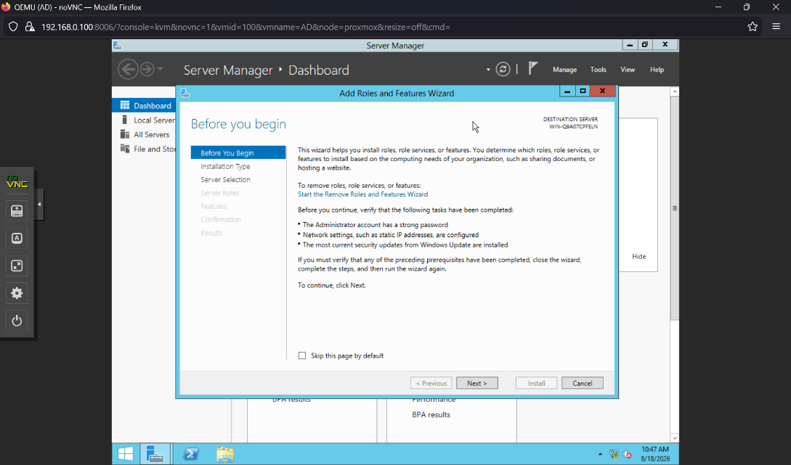

Selected Active Directory Domain Services and DNS Server then click Next. Skip features.

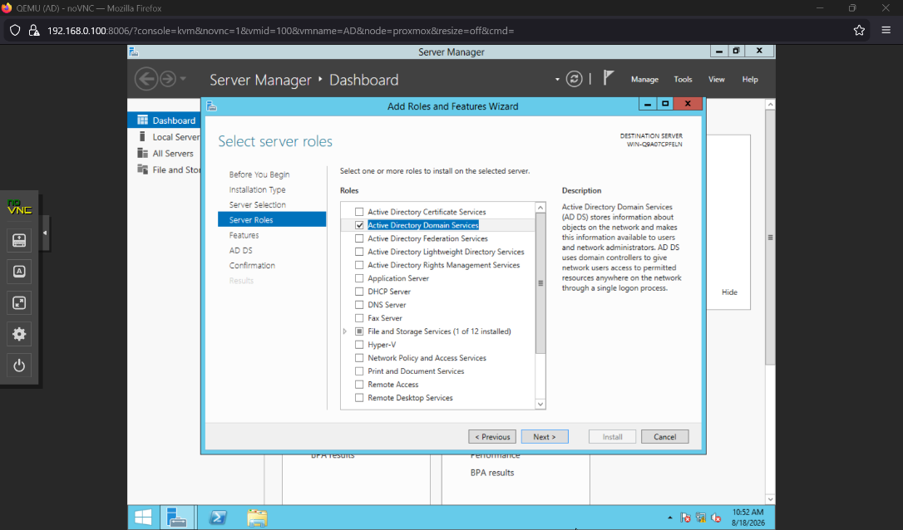

It will start installing. When it's finished, select Close.

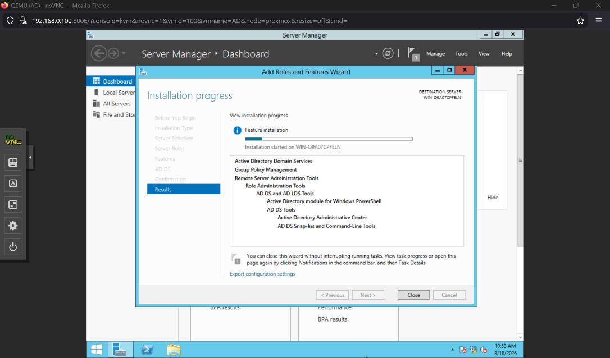

## Setting up Domain

Promote the Windows Server 2012 machine to be domain controller.

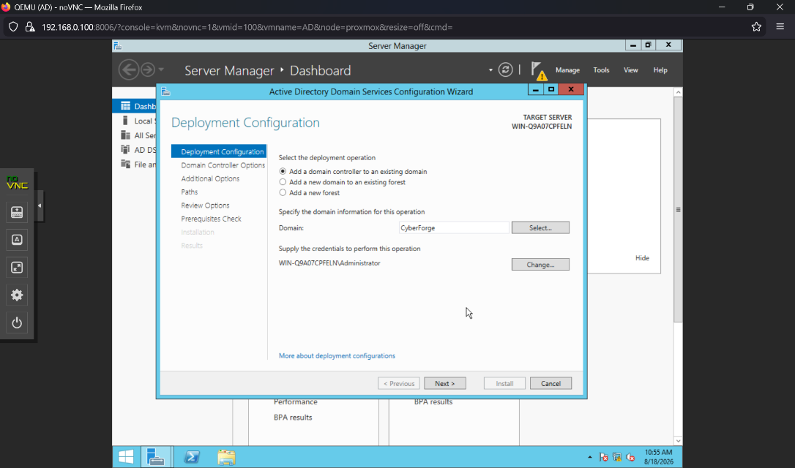

Below is a screenshot of all the selected options to set. Click next.

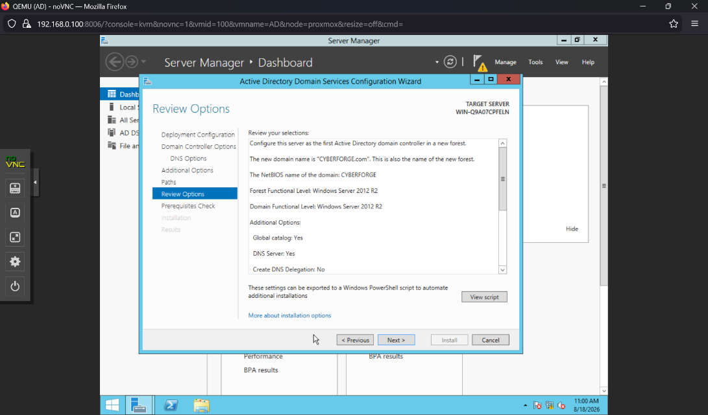

Confirm the correct prerequisites are checked and select Install.

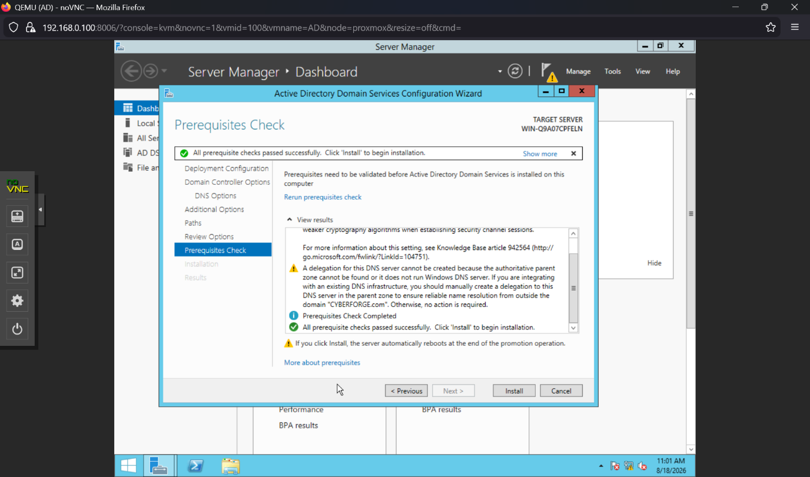

The Machine will restart. After a restart, the Domain will appear on the logon screen.

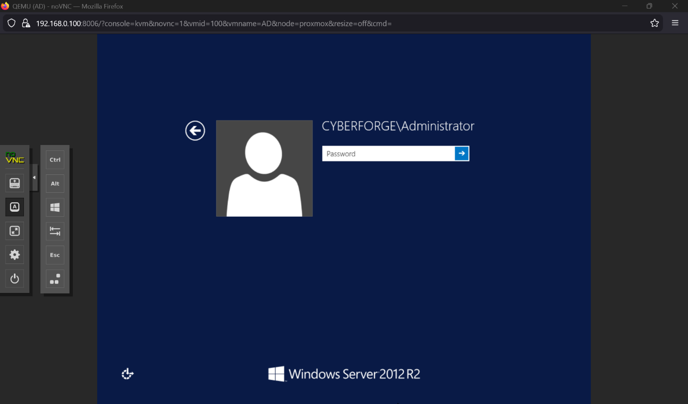

The domain will be up and running.

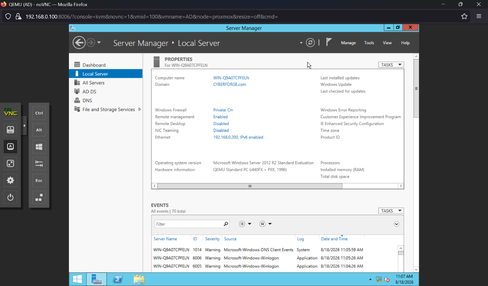

## Configuring DNS Server

Configuring DNS Server

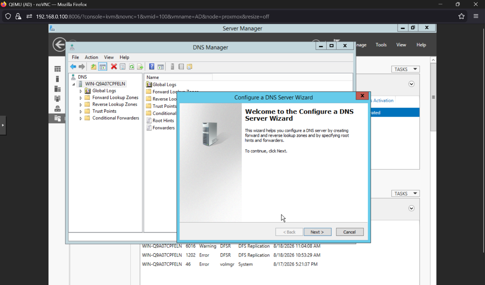

Configuring DNS server and creating forward lookup zone.

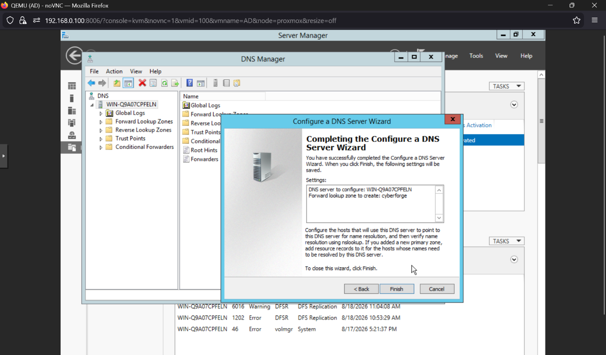

## Joining Domain on Workstation PC

Joining the CYBERFORGE domain

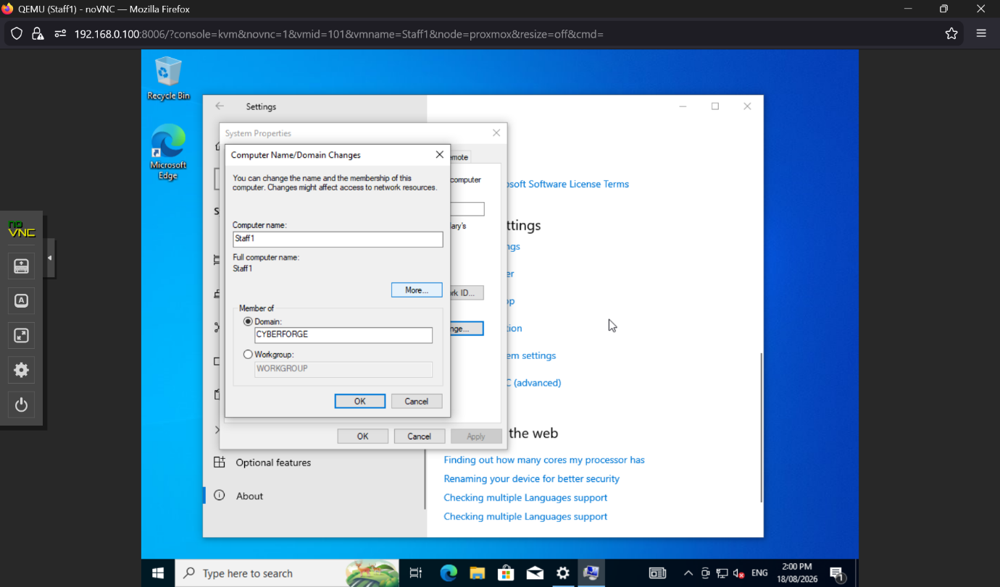

It will ask to log on with an administrator account then appear with the message "Welcome to the CYBERFORGE.com domain. The workstation will then require a restart.

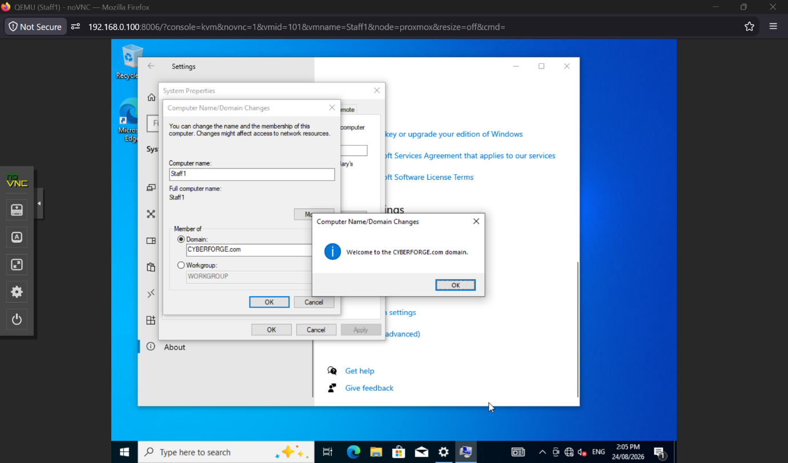

After logging into the workstation using one of the AD user accounts, we can check and see we are in the domain.

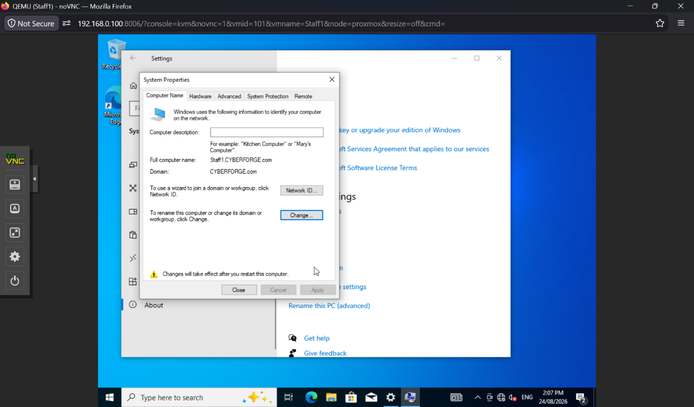

