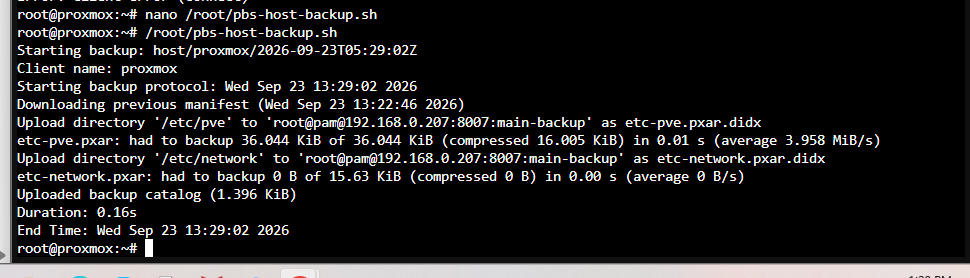
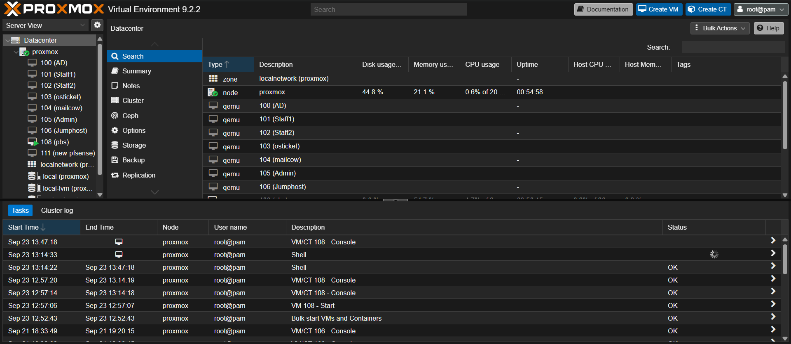
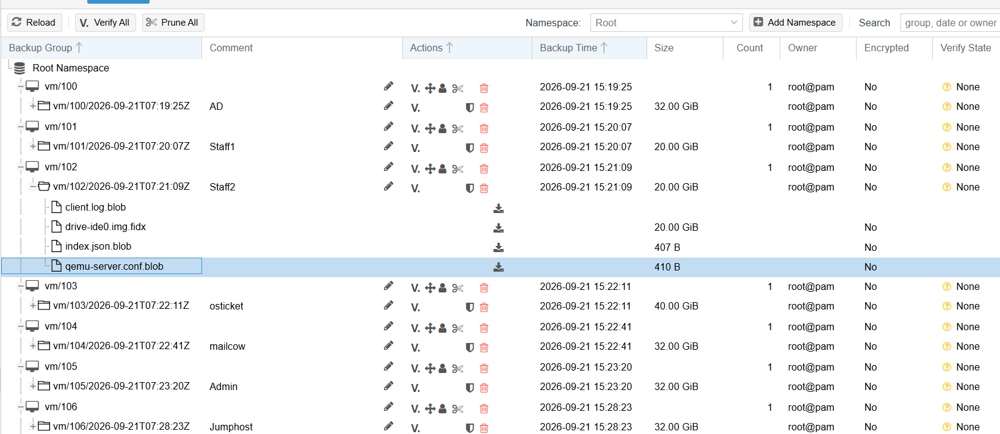
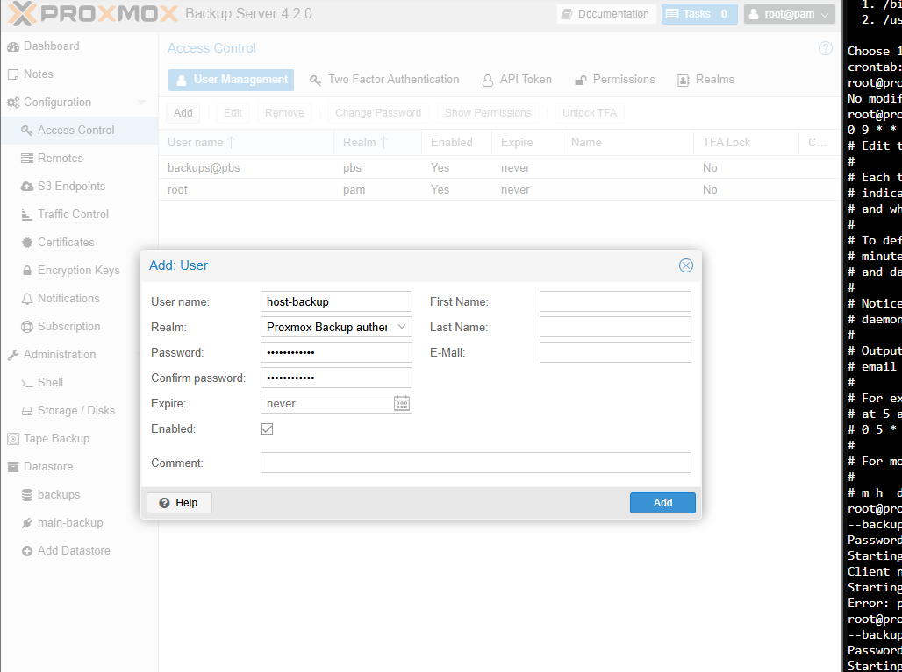
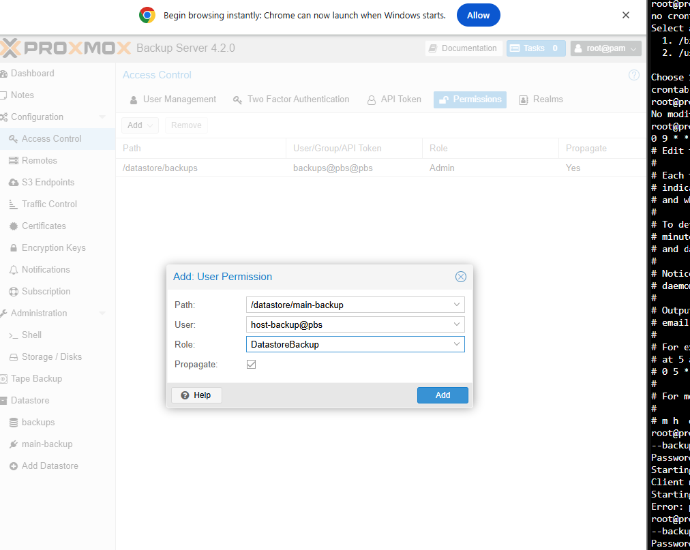
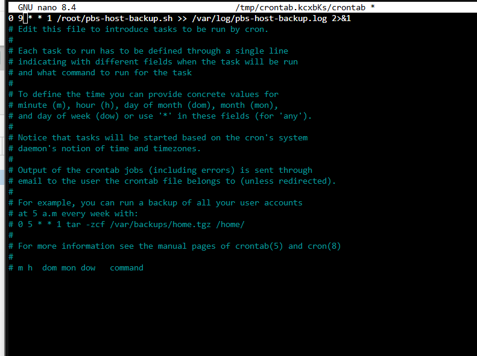

Proxmox Backup Server (PBS) and Backups Guide

-   Backups are currently scheduled to occur between 8-9am every Monday
    morning. As the server will likely be offline during this time,
    frequent manual backups are suggested.

**For manual backup of VMs**

In Proxmox PVE \>\> Datacenter \>\>

**For manual backup of configuration files**

In PVE shell, execute the command:

/root/pbs-host-backup.sh

{width="5.790123578302712in"
height="1.4444444444444444in"}

**PBS VM**

1.  Download the latest PBS ISO from the official Proxmox downloads
    page:
    <https://www.proxmox.com/en/products/proxmox-backup-server/overview>

2.  On Proxmox Virtual Environment (PVE): navigate to Datacentre node
    storage ISO Images Upload

3.  Create a new VM in PVE and fill out as follows:

    a.  **General**: PBS

    b.  **OS**: Select the uploaded PBS ISO

    c.  **System**: leave default

    d.  **Disk**: 32GB

    e.  **CPU**: 2 cores

    f.  **Memory**: 2048-4096 MB

    g.  **Network**: default bridge

{width="6.268055555555556in"
height="2.8041666666666667in"}

4.  Review and click Finish but do not start.

5.  Attach external drive to the Proxmox server.

6.  Select the new VM, navigate to Hardware Add USB Device. Choose USB
    Vendor/Device ID and select your external drive from the dropdown
    list.

7.  Start the VM. Open its Console tab and step through the PBS
    installer

    a.  Accept EULA

    b.  Select target disk (the virtual disk you created not external
        drive)

    c.  Set timezone/keyboard

    d.  Set a root password and email

    e.  Configure a static IP/gateway/DNS for the VM

        i.  192.168.0.207

8.  After it reboots, search <https://192.168.0.207:8007> and login with
    the root user and password.

**VM Backup**

9.  Navigate to Datastore Add Datastore.

    a.  Name: main-backup

    b.  Point the path at the mount location of the external drive

    c.  Set a garbage-collection schedule (weekly is default)

10. On PVE, go to Datacentre Storage Add Proxmox Backup Server

    a.  Enter PBS Server's IP, datastore name and roots credentials.

11. In PVE, go to Datacentre Backup Add.

    a.  Choose new PBS storage as the target.

    b.  Select All VMs to backup

    c.  Schedule: Mon 8am

    d.  Retention:

12. Run now for immediate manual backup. Once finished, you should have
    a list of VMs that have been successfully backed up with dropdowns
    shown in the image below.

{width="6.268055555555556in"
height="2.720833333333333in"}

**Configuration Backups**

(for /etc backups)

1.  On the PBS web GUI navigate to Access Control Users Add

    a.  **User name:** host-backup

    b.  **Realm dropdown:** pbs

    c.  **Password:** backup!6\$&\<?

    d.  **Save**

{width="5.6in"
height="3.9882349081364827in"}

2.  In PBS console, confirm user added with command:

proxmox-backup-manager user list

3.  On the PBS web GUI, navigate to Access Control Permissions Add

    a.  **Path:** /datastore/main-backup

    b.  **User:** host-backup@pbs

    c.  **Role:** DatastoreBackup

    d.  **Propagate:** Yes

{width="5.740972222222222in"
height="3.682353455818023in"}

4.  Manually test the backup in PVE Shell with command:

proxmox-backup-client backup \\

etc-pve.pxar:/etc/pve \\

etc-network.pxar:/etc/network \\

\--backup-type host \\

\--backup-id \$(hostname) \\

\--repository <root@pam@pbs-192.168.0.207:main-backup>

If prompted, accept the fingerprint.

5.  In PBS GUI navigate to main-backup Content. A new group should be
    present.

6.  Hand ownership to host-backup@pbs with the following command in PVE
    shell:

proxmox-backup-client change-owner host/root host-backup@pbs \\

\--repository <root@pam@192.168.0.207:main-backup>

Enter root@pam password when prompted

7.  Store host-backup users password safely with the following command:

mkdir -p /root/.pbs-secrets

echo '*password*' \> /root/.pbs-secrets/pbs-password

chmod 600 /root/.pbs-secrets/pbs-password

8.  Create the backup script with the following command:

> cat \> /root/pbs-host-backup.sh \<\< 'EOF'
>
> #!/bin/bash
>
> export PBS_PASSWORD_FILE=/root/.pbs-secrets/pbs-password
>
> proxmox-backup-client backup \\
>
> etc-pve.pxar:/etc/pve \\
>
> etc-network.pxar:/etc/network \\
>
> \--backup-type host \\
>
> \--backup-id \$(hostname) \\
>
> \--repository <host-backup@pbs@192.168.0.207:main-backup>

EOF

> chmod 700 /root/pbs-host-backup.sh

9.  Manual test command:

> /root/pbs-host-backup.sh

10. Create a cron job for backup to be executed every Monday morning at
    9am:

crontab -e

0 9 \* \* 1 /root/pbs-host-backup.sh \>\> /var/log/pbs-host-backup.log
2\>&1

crontab -l

{width="6.268055555555556in"
height="4.68125in"}

11. Verify with the command:

cat /var/log/pbs-host-backup.log
