# Cyberforge 4.0 - Proxmox Virtual Environment Setup Instructions
``01/09/2026``


1.  Navigate to: <https://www.proxmox.com/en/downloads/proxmox-virtual-environment>

2.  Download "Proxmox VE 9.2 ISO Installer" or later

3.  Flash the ISO to a USB for installation:

    a.  **Linux**:

        i.  Go to the file location of the download and open a terminal in that folder by right clicking -\> open terminal here

        ii. Within terminal, enter:

```sudo dd if=/path/to/proxmox-ve.iso of =/dev/sdX bs=4M status=progress```
> **AND** **replace:**
```path/to/proxmox-ve.iso```
> with your path and file name
> **AND** **replace:**
```/dev/sdX/```
> with your USB Drive identifier name. (Example below)

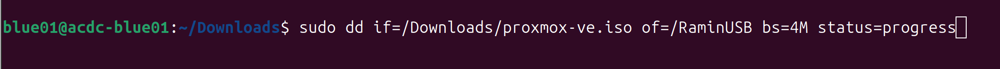

b.  **Windows**:

    i.  Navigate to: <https://rufus.ie/en/#download>

    ii. Download "rufus-4.15.exe" or newer and install

    iii. Open rufus, and under "Device", select your USB device as the target device

    iv. Under "Boot Selection", select your ISO file to flash

    v.  Click Start

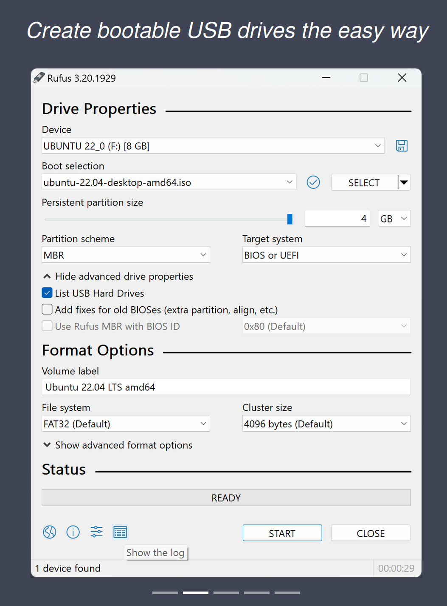

4.  Eject your USB safely from your device

5.  Plug your USB with the flashed ISO into your target device you would like Proxmox VE to be installed in

6.  Enter the boot menu of the target device through the BIOS, and select your USB as the boot device

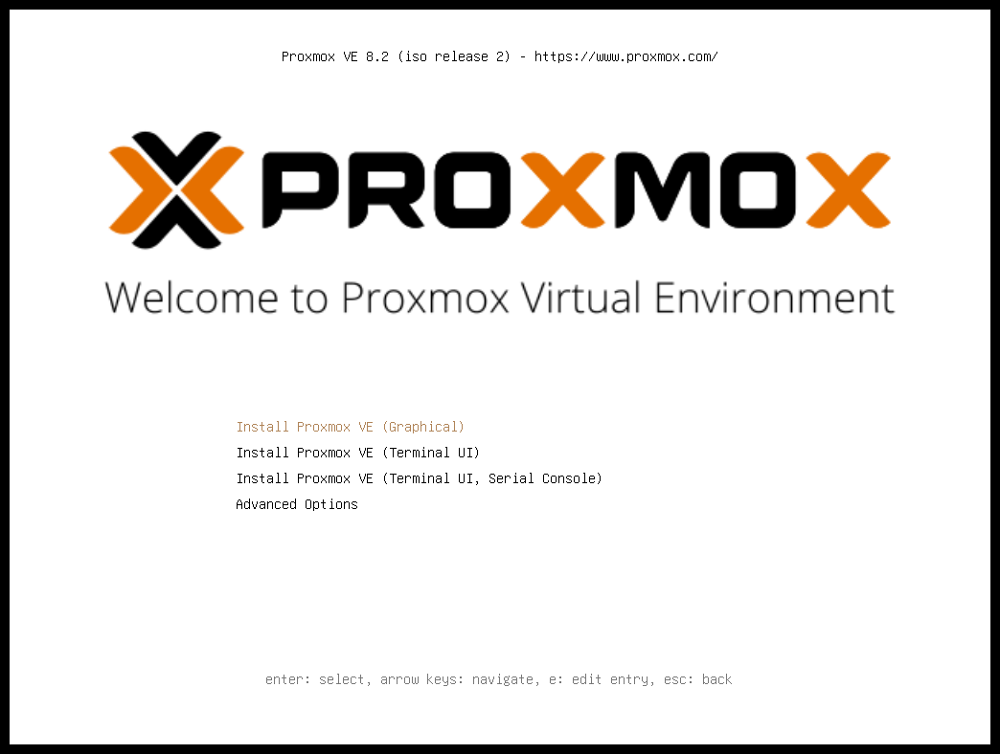

7.  Once booted in, click on "Install Proxmox VE (Graphical)"

8.  At the bottom of the screen make sure the "Target Hard disk" is the device's main storage location

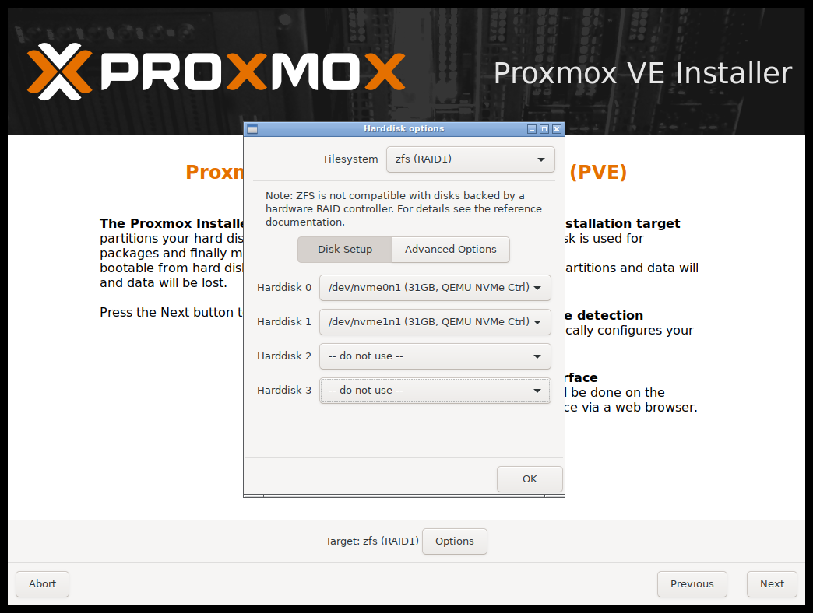

9.  Click Next

10. Set your "Country, Time zone and Keyboard layout" to your preferences

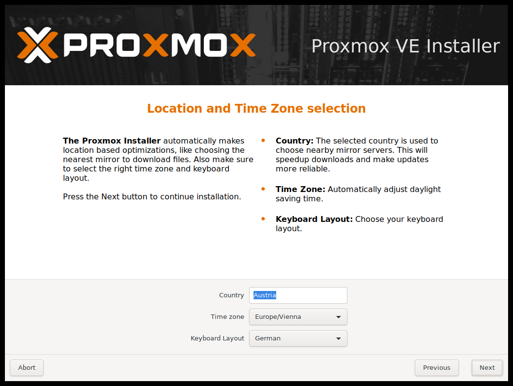

11. Click Next

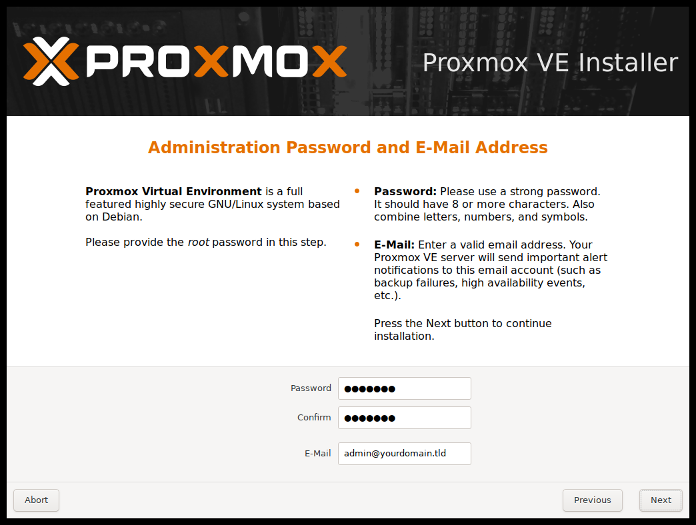

12. Enter a valid email address and password for your proxmox root password, then note these pieces of information

13. Click Next

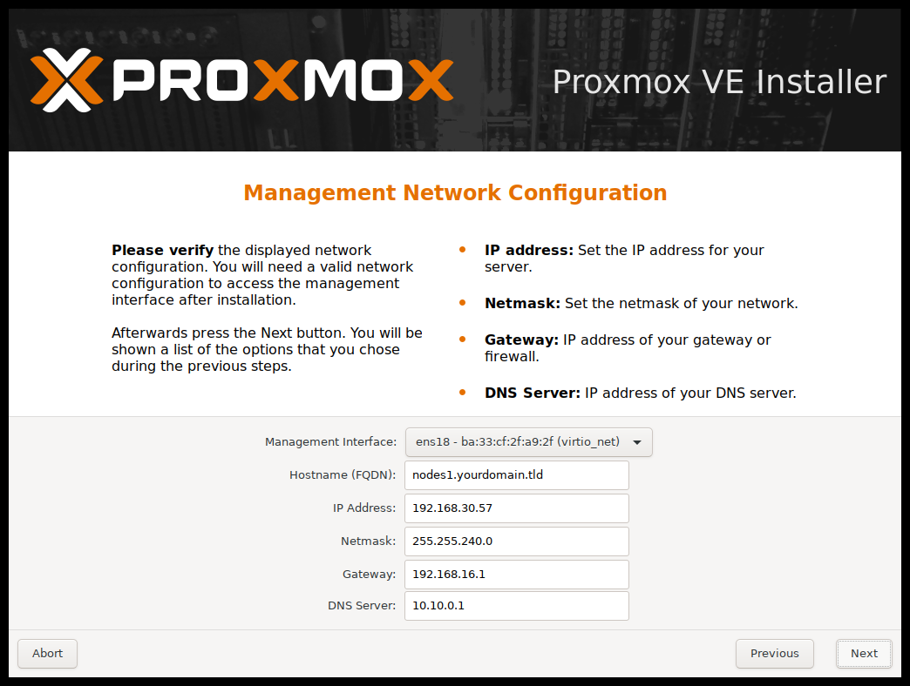

14. If familiar with IP address subnets of your home network, configure your "IP Address, Gateway and DNS Server" accordingly, otherwise leave these options by default

15. For management interface, if there are multiple options, click on the first network interface not starting with "WL\....", as that is the wireless interface

16. Click Next

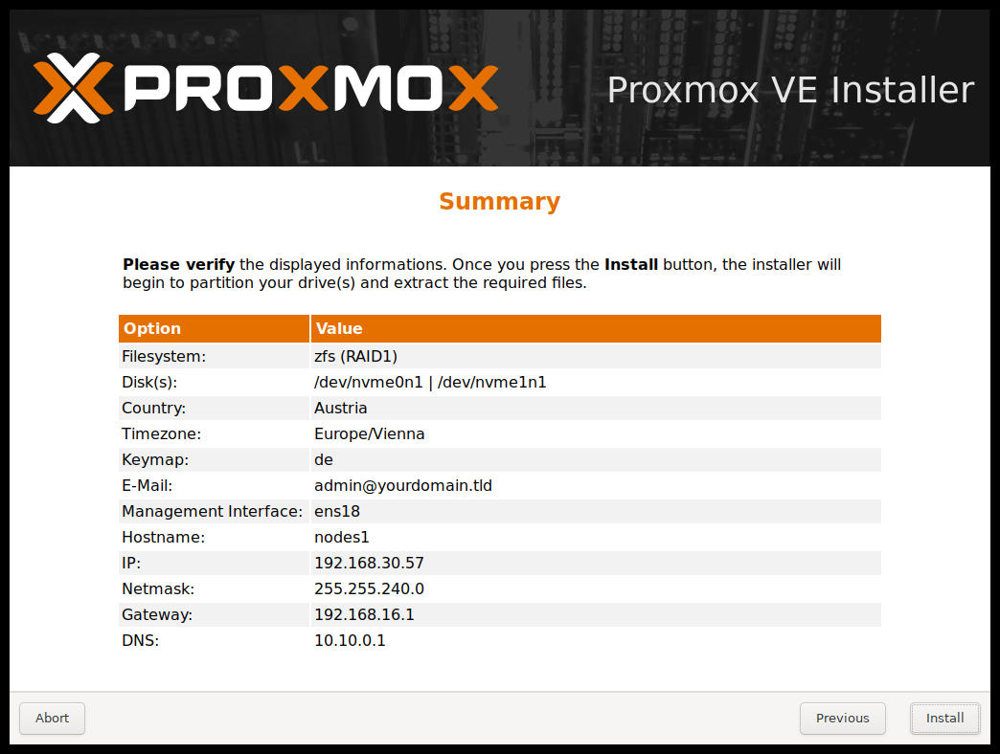

17. Make sure the information is correct and check the "Automatically reboot after successful installation" box and click Install

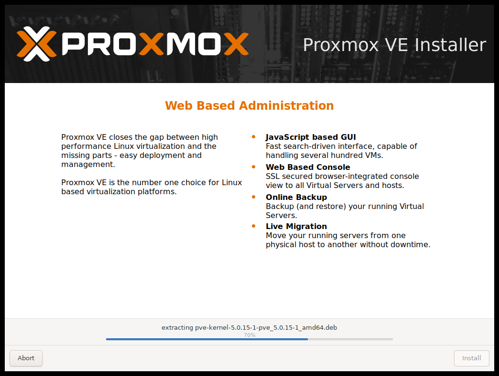

18. After device has rebooted, unplug your USB with the ISO, so that the device can boot from Proxmox installation

19. Once the screen boots up, it will display the chosen or default IP range you set along with the port to configure the Proxmox VE server

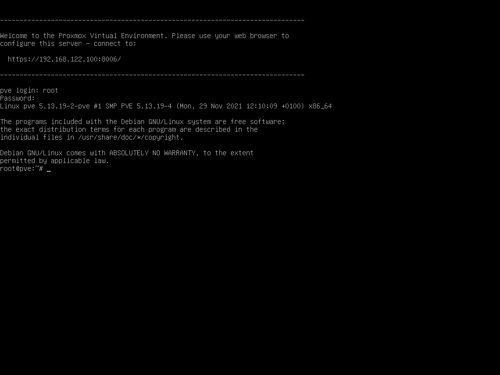

20. For "pve login" / "proxmox login", enter ```root```

21. For "password", enter ```your configured password```

22. With a separate device, that is connected via ethernet to the Proxmox machine, statically apply the laptop an IP address in the same range as the Proxmox machine:

    a.  **Windows**:

        i.  Navigate to your network adapter for ethernet connections

        ii. Right click -\> Properties

        iii. Configure Internet Protocol Version 4 (TCP/IPv4) options

        iv. Check the "Use the following IP Address" (SKIP if Proxmox can dynamically assign IP with its own DHCP capabilities, we had to as it could not at the time):

> (If machine is: "192.168.0.100:8006" (As shown on the Proxmox VE) login page before logging in)

1.  IP Address:

    a.  Enter ```192.168.0.XX``` (replace XX with any number)

2.  Subnet Mask:

    a.  Enter ```255.255.255.0```

3.  Default Gateway:

    a.  Enter ```192.168.0.1```

```{=html}
<!-- -->
```
23. Navigate to Proxmox's web browser IP and port shown on the login page via a web browser. E.g: ```192.168.0.100:8006```

> 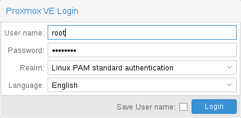

24. Enter ```root``` as username

25. Enter ```your chosen password``` as password

26. Click "Okay" once the valid subscription dialogue box pops up

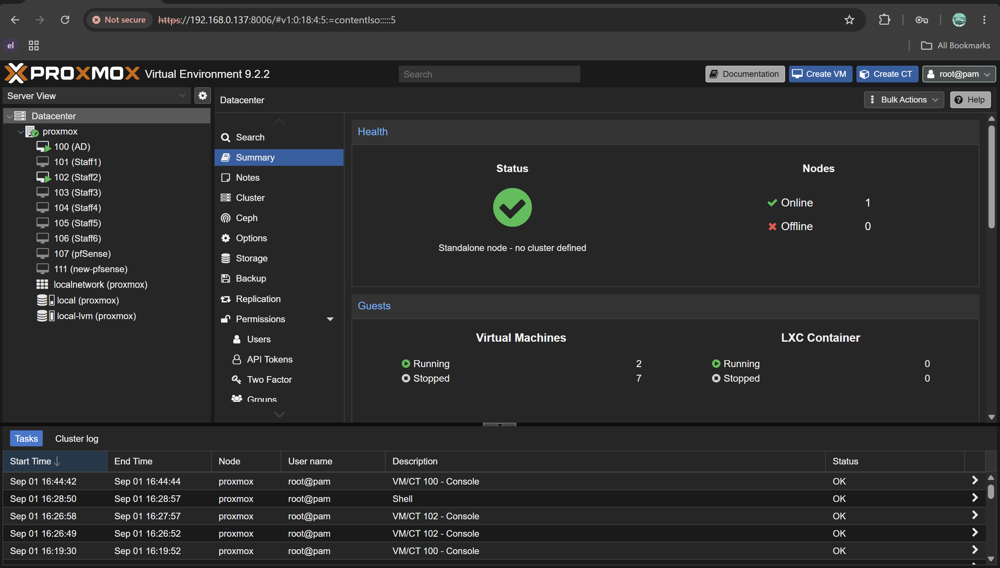

27. The dashboard will be present now

28. You have successfully setup Proxmox and logged into the configuration server
