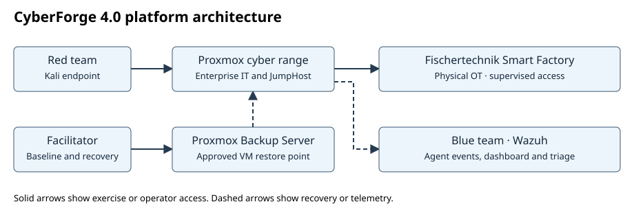
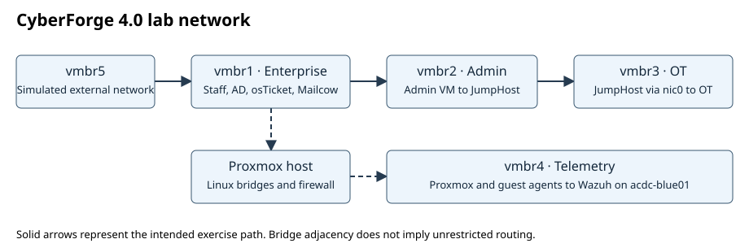

# CyberForge 4.0 — Industry 4.0 Smart Factory Cyber Range for Red and Blue Teaming

CyberForge 4.0 is an Edith Cowan University CSG3101 Applied Project. It combines a Proxmox-hosted enterprise IT environment with the Fischertechnik Smart Factory operational technology (OT) testbed. The capture-the-flag (CTF) exercises let red teams investigate two paths from enterprise access to an OT boundary while blue teams reconstruct activity from Wazuh telemetry.

## Get started

| Task | Guide |
| --- | --- |
| Log in to Proxmox, start the VMs, or restore a baseline | [Operator guide](operator-guide/) |
| Find VM IDs, interfaces, installed software and access instructions | [Inventory and access](operator-guide/inventory.md) |
| Run Spear Phishing or Network Discovery and submit evidence | [CTF scenario guides](ctf-scenarios/) |
| Practice flag submission and blue-team triage in a browser | [GitHub Pages simulation](https://chiraxist.github.io/CyberForge/) · [Simulation source](docs/index.html) |

## Network architecture

The deployed topology uses Proxmox Linux bridges and firewall rules. The Admin VM connects enterprise and administration segments. JumpHost is the intended access point from administration toward OT. Wazuh runs on a separate blue-team laptop. The simulated external segment is used for Scenario 1. See the [inventory](operator-guide/inventory.md) for the documented addressing and interface details.

Run live exercises on the authorized lab range with its external uplink isolated. Keep physical OT interaction within the approved exercise scope. The browser simulation uses synthetic events and its own flags.

## Citation

Grover, A., Appleyard, B., Christie, H., Ahuja, H., Tucci, K., & Qambary, R. (2026). *CyberForge 4.0: Industry 4.0 smart factory cyber range for red and blue teaming* [Software]. Edith Cowan University. https://github.com/chiraxist/CyberForge

See [CITATION.cff](CITATION.cff) for machine-readable metadata. The CSG3101 final project report lists Dr Ahmad Mohsin and Nandiya as supervisors.
