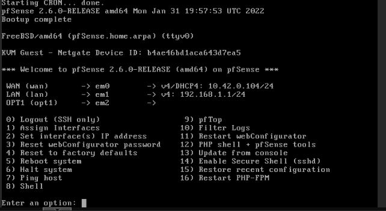
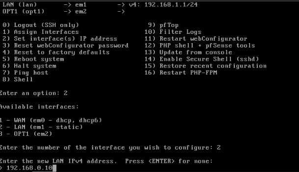
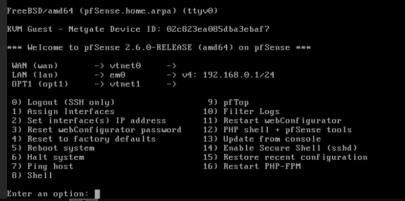
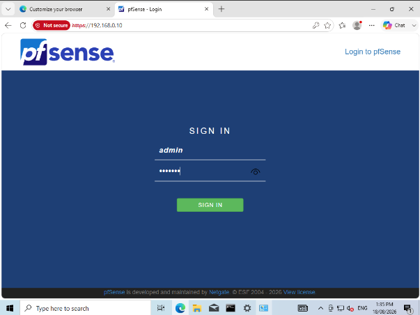
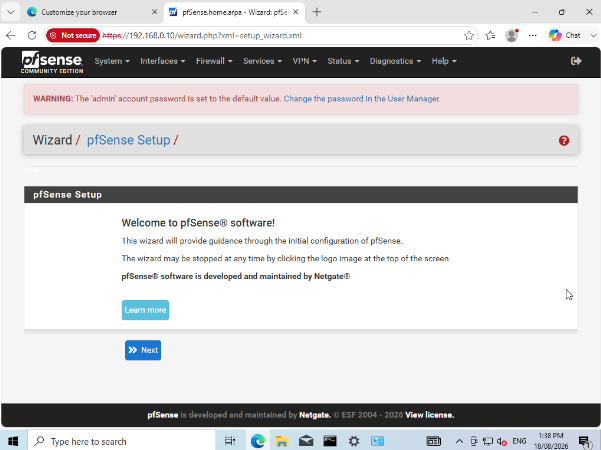
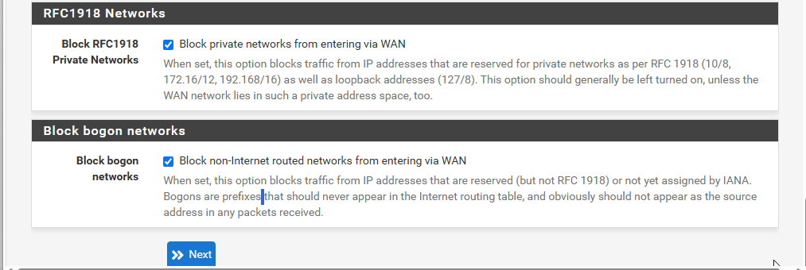
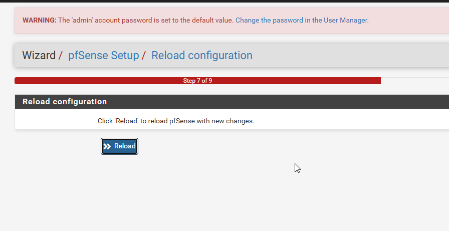
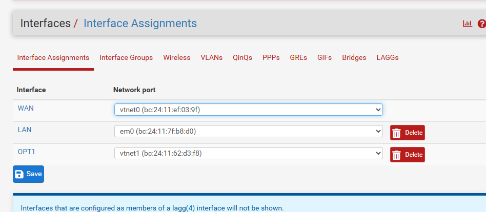

Pfsense default IP configuration:

We must change the IP configuration to allow connectivity with the staff and pfsense:

Changed the IP configuration:

In proxmox web ui head to Datacenter/proxmox/Staff2/Console, remote into the computer

Go into staff 2 computer and login to pfsense as we should have connectivity now. This can be done by going to the browswer and typing in pfsense's IP address which we set to 192.168.0.1

Pfsense will automatically make you go through a wizard. Go thru the wizard of pfsense:

Pfsense is asking us to see if we want it to be part of a domain, we allocate cyberforge to become part of its domain. Pfsense domain setup:

Override DNS as well

Set the time server to Australia/perth:

Leave WAN as DHCP for now as we don't need internet to pass through pfsense:

Block WAN traffic to prevent any unwanted packets to come through:

Leave IP as 192.168.0.1 and subnet mask as 24:

Set pfsense password as "pfsense" and leave it at that default password

Reload everything for the configuration to be setup:

Pfsenese is now configured:

Here, we can see pfsense home screen setup after going through the wizard:

Theres only 2 interfaces instead of 3 because we've only configured the LAN to communicate with pfsense (within vmbr1 network), and the other is the WAN which is not in use currently. The 3^rd^ interface is not showing because we didn't assign anything to it yet

However, when we head to check the interfaces, we can see the 2 interfaces are assigned and the 3^rd^ one isn't assigned to anything as of yet.

We can see the configuration of the network adapters of pfsense. Vmbr1 is set to em0, Vmbr2 is set to WAN, vmbr3 is set to OPT1. Since LAN is set to vmbr1, we set that network adapter's IP address to 192.168.0.1 so the staff network can communicate with pfsense (because they're all on the .0 subnet and their firewalls have been configured to allow traffic to pass through).

